# Understanding AI: from next-word prediction to agents

Figures and animations originally created for a retreat presentation. The aim is to explain LLMs and agents visually.

Some visualizations are taken almost directly from 3Blue1Brown (check out his amazing [YouTube channel](https://www.youtube.com/@3blue1brown)), others inspired by his work and rendered with [manim](manim/), a Python library for mathematical animations. 

- **Schematics**: SVG figures for slides (PNG previews below).
- **Animations**: made with [manim](manim/), based on 3Blue1Brown's
  [Large Language Models explained briefly](https://www.youtube.com/watch?v=LPZh9BOjkQs).
  The GIFs below are small previews; render full-quality videos with `manim/render.sh`.

## Schematics

### From next-word prediction to agents

The same model gets the same question five times. Four steps change what it can do.

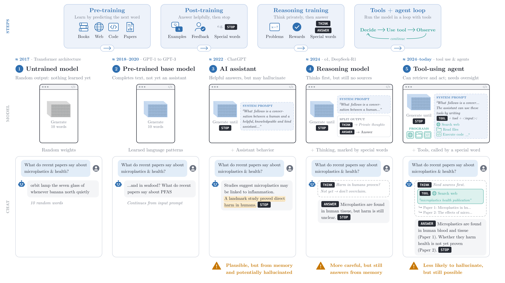

[SVG](llm_to_agentic_ai_v2.svg) · older version: [SVG](llm_to_agentic_ai.svg), [PNG](llm_to_agentic_ai.png), [notes](docs/llm_to_agentic_ai.md)

### Security overview

An agent has two parts to secure: the model and the software around it. Who controls each?

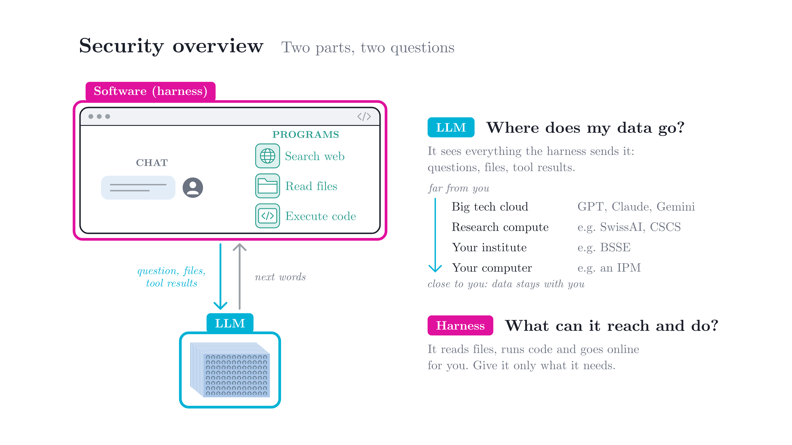

[SVG](security_overview.svg)

### Security: three combinations

Big tech or private, for the software and for the model.

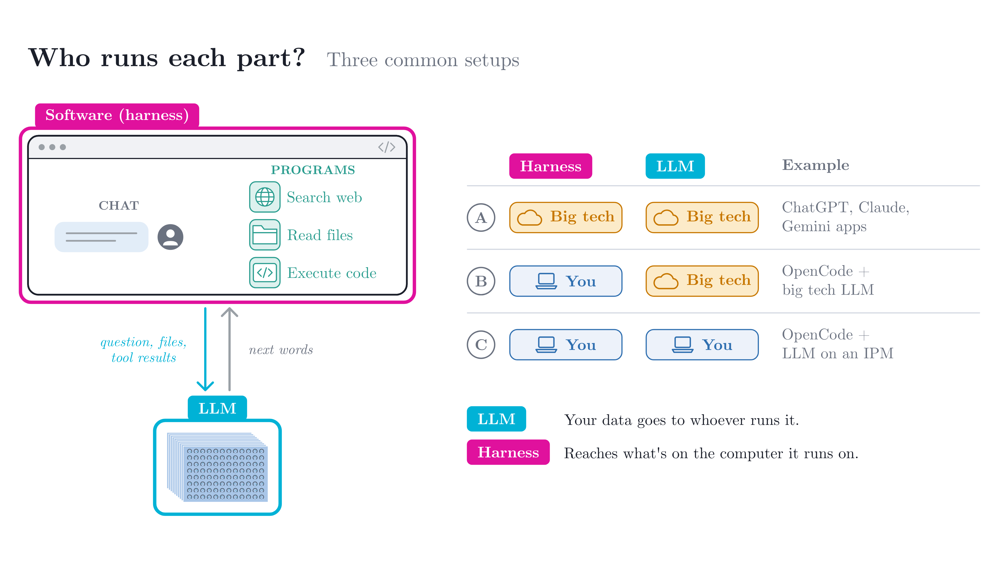

[SVG](security_combinations.svg)

### Wiki search bot

A bot that searches the wiki and cites the pages.

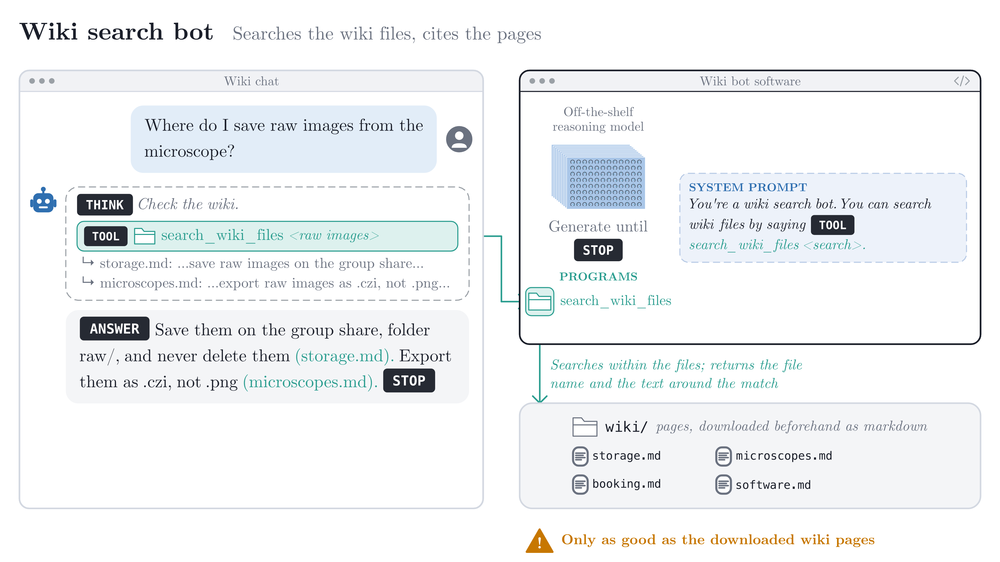

[SVG](wiki_chatbot.svg)

### Course tutor bot

A tutor in JupyterLab that gives hints, not solutions.

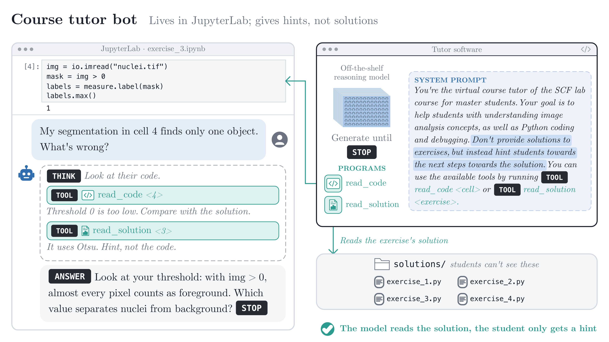

[SVG](teaching_assistant.svg)

## Animations

### How a language model works

**Next-word prediction.** The model guesses the next word.

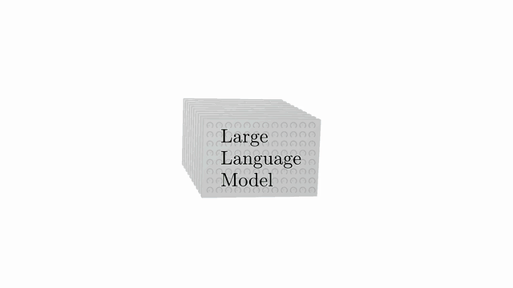

**Chatbot.** Predicting one word at a time writes a chatbot's answer.

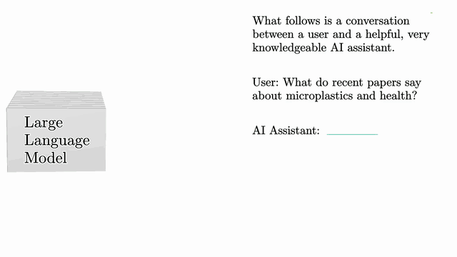

**Training 1: lots of text.** The model learns from huge amounts of text.

**Training 2: parameters.** The model is a machine with many dials.

**Training 3: learning from an example.** Each example nudges the dials a little.

### From next-word prediction to agents

**Overview.** The schematic above, built up step by step.

**1. Untrained model.** Random output.

**2. Base model.** Trained on text, it continues the question instead of answering it.

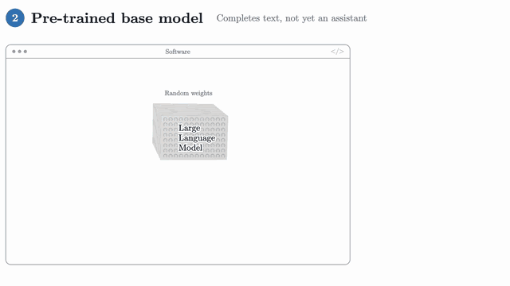

**3. Assistant.** Trained on conversations, it answers helpfully, but may make things up.

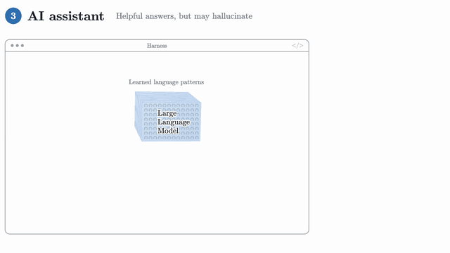

**4. Reasoning model.** It thinks first, but still answers from memory.

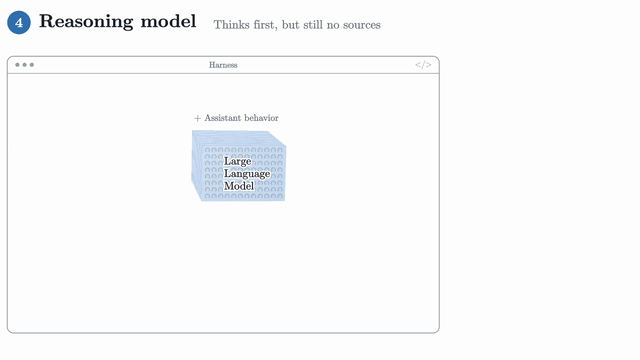

**5. Agent.** It uses tools, such as a web search, and cites its sources.

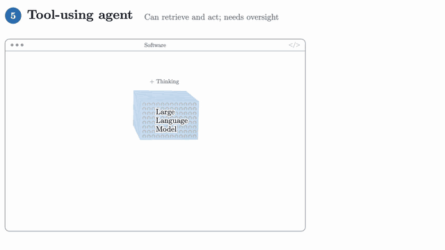

Stages 2–4 also come without the training part (`Stage2BaseModelInference` etc. in [manim/](manim/)).

### Example agents

**Wiki search bot.** Searches the wiki and cites the pages.

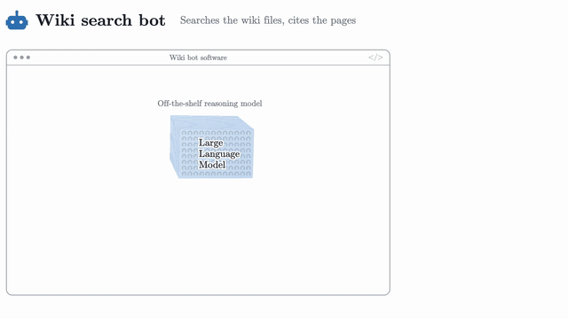

**Course tutor bot.** Reads the student's code and the hidden solution, then gives a hint.

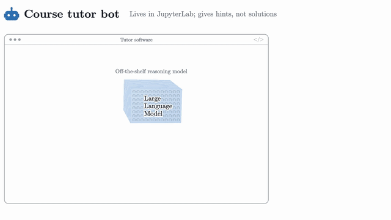

**Privacy.** What gets sent to the model provider, and how a local model keeps it in-house.

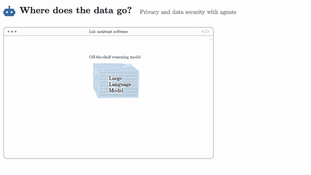

## More

- [manim/README.md](manim/README.md): how to render, and what each scene shows in detail.
- [docs/llm_to_agentic_ai.md](docs/llm_to_agentic_ai.md): design notes for the first schematic.

## License

[CC BY-NC-SA 4.0](LICENSE): free to share and adapt for non-commercial use, with credit, under
the same license. When reusing a figure or animation, credit it as e.g. *"Marvin Albert, adapted
from 3Blue1Brown, CC BY-NC-SA 4.0"*.

Adapted from the code of [3Blue1Brown's videos](https://github.com/3b1b/videos) (CC BY-NC-SA 4.0).
The fonts in `manim/assets/fonts/` are under the [SIL Open Font License](manim/assets/fonts/OFL.txt).
